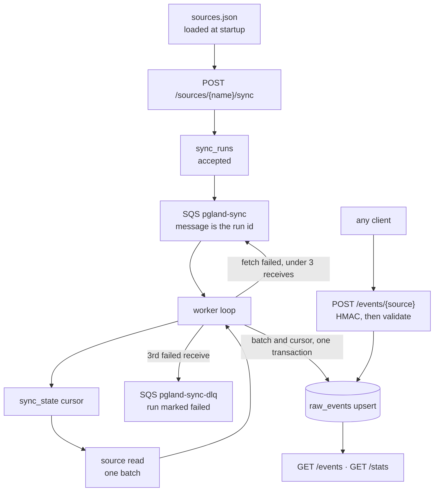

# Design

pgland lands event data from many systems in one Postgres table, keeps it raw, and serves reads and counts on top. One Go binary runs as two processes: the HTTP API (`pgland`) and the sync worker (`pgland worker`). Postgres stores the events. SQS holds accepted pull runs until a worker finishes them.

## Processes

The API accepts work and serves reads. It does not call source APIs.

The worker is a loop on the sync queue, started with `pgland worker`. Start it before calling sync. An empty queue means the loop waits and fetches nothing. One queue message is one batch. The worker does not walk later batches by itself. The next batch is another `POST /sources/{name}/sync`.

## Data flow

Both paths produce `event.Record` values and write them through the same upsert. Nothing is transformed on the way in. Derived tables, when they exist, are rebuilt from `raw_events`.

### Pull

`sources.json` is loaded when each process starts. `POST /sources/{name}/sync` only accepts a name that is already loaded. It inserts `sync_runs` as `accepted`, enqueues that run id, and returns `202`. The message body is the run id. The batch is not on the queue.

The worker receives the message and loads the run. The source name on the run selects the puller and the cursor in `sync_state`. The cursor is where the next batch starts. For the HTTP source it is the next page URL. The worker fetches that one batch, upserts `raw_events`, and moves the cursor in one transaction, then marks the run `finished` and deletes the message. `raw_events` does not store the run id. A run that is no longer `accepted` is not fetched again, so a redelivered message after a finish is deleted and skipped.

Visibility and the dead-letter queue belong to the queue message. The queue hides a received message for `QUEUE_VISIBILITY_SECONDS` (default 60). A failed fetch is left in place, so the same run id returns after that timeout and `ApproximateReceiveCount` goes up. On the third failed receive the worker marks the run `failed` and still does not delete. The queue's redrive policy (`maxReceiveCount` 3) then moves the message to `pgland-sync-dlq`.

### Push

`POST /events/{source}` is a webhook. The body is a JSON array of `{id, type, occurred_at, data}`. The client already holds the events, so this path does not use the queue. When `INGEST_SECRET` is set, the raw body must carry `X-Pgland-Signature: sha256=<hex HMAC-SHA256>`. The check runs before the body is parsed. The API then validates the body, upserts `raw_events`, and only then returns success. Any source name works. It does not have to be in `sources.json`. A failed request is the client's to retry. The upsert key makes that retry safe.

## Packages

| package | role |
| --- | --- |
| `cmd/pgland` | Wires config, store, sources, the HTTP server, and the sync worker. |
| `internal/config` | Environment variables. |
| `internal/event` | `Record` and its validation. |
| `internal/source` | Config-driven HTTP JSON pull source. One response page is one batch. `Link: rel="next"` paging. |
| `internal/sqsqueue` | Sync queue and its dead-letter queue. |
| `internal/syncjob` | One accepted pull: cursor, one batch, store. |
| `internal/store` | Postgres pool, embedded `schema.sql`, upsert, cursors, sync runs, stats. |
| `internal/httpapi` | Routes and push signature check. |

## Data model

`raw_events`, `sync_state`, and `sync_runs` are defined in [`internal/store/schema.sql`](../internal/store/schema.sql). That file is applied on start with `CREATE TABLE IF NOT EXISTS`. A new table is a new statement there. Changing an existing column needs a migration; one is added when a released schema first has to change in place.

## Idempotency

- Every write is `INSERT ... ON CONFLICT (source, external_id, event_type) DO UPDATE` on payload and occurred_at, skipped when neither changed. Retries, repeated pushes, and re-read batches converge on one row without rewriting it.
- A sync writes its batch and moves its cursor in one transaction. The cursor never runs ahead of stored events.
- One accepted sync run per source, enforced by a partial unique index. A second accept gets `409`. A run that is no longer accepted is not fetched again.

## Pull paging

The HTTP source's batch is one response page. The cursor is the next page URL from the `Link: rel="next"` header. Links to another host are ignored, and a saved cursor on another host is rejected, so a sync only ever calls the configured host. Without a next link, the cursor stays on the current page so later syncs pick up appended records.

APIs that page in the response body (a `next` field or token) are not supported yet.

## Analytics

`GET /stats` groups by source and type, and by UTC day on `coalesce(occurred_at, ingested_at)`. For deeper analysis, point Grafana, Metabase, or plain SQL at the same database.

## Roadmap

- Body-based paging: `next_path` for APIs that return the next cursor or URL in JSON.
- Scheduled sync per source, so pulls do not need an external trigger.
- Database poll source: `SELECT ... WHERE updated_at > cursor`, one batch per sync.
- Normalized tables derived from `raw_events`, rebuilt idempotently.
- A batch copy of normalized rows into a separate reporting schema, kept apart from the live tables.
- Container image and a compose file that runs pgland next to Postgres.
